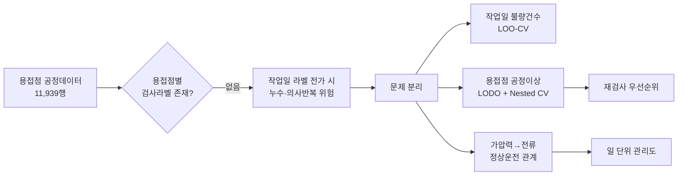

# WeldProof

## 라벨 해상도 불일치 환경에서 누수 없이 검증하는 로봇용접 제조 AI

[](https://github.com/minster0422/kamp-welding/actions/workflows/portfolio-quality.yml)
[](https://www.python.org/)


> 설명변수는 **용접점 11,939개**인데 정답 라벨은 **작업일 집계 39건**이었다.
> 이 불일치를 무시하면 용접점 단위 성능이 구조적으로 과대평가된다.
> 그래서 예측 단위를 라벨 해상도에 맞춰 과제를 재정의하고,
> **용접점 단위 불량 예측이 이 데이터로 불가능함을 다섯 겹으로 입증**했다.

저항점용접(RSW) 공정데이터 분석. 제6회 K-인공지능 제조데이터 분석 경진대회 제출물.

> [!NOTE]
> 이 저장소는 팀 프로젝트 [`dlwogud/kamp-welding`](https://github.com/dlwogud/kamp-welding)을 기반으로 한
> **`@minster0422`의 제조 AI 포트폴리오 확장본**이다. 대회 당시 공동 결과와 포크 이후 개인 개선을
> 구분해 기록한다. 원본 분석 결과를 개인 단독 성과로 주장하지 않는다.

**읽는 시간에 따라 선택:** [30초 요약](#30초-요약) · [3분 프로젝트 카드](PROJECT_CARD.md) · [면접 질문과 답변](docs/INTERVIEW_GUIDE.md) · [전체 기술보고서](report/결과보고서_본문.md)

## 30초 요약

| 질문 | 답변 |
|---|---|
| 해결하려던 문제 | 최종 품질검사 전에 로봇용접의 불량위험과 공정이상을 파악할 수 있는가? |
| 가장 큰 제약 | 공정변수는 용접점 11,939행인데 불량 라벨은 8개 작업일의 집계 39건이며, 두 단위를 연결할 키가 없음 |
| 핵심 판단 | 작업일 라벨을 모든 용접점에 복제하면 누수가 발생하므로 작업일 예측과 용접점 이상탐지를 분리해야 함 |
| 최종 설계 | 작업일 불량건수 예측 + 제조 물리 기반 용접점 이상탐지 + 정상운전 관계 + 일 단위 관리도 |
| 대표 결과 | 합성 7유형 평균/최악 AUC 0.971/0.954, 외부 실제라벨 AUC 0.899, 공정 이동 3/3·안정일 오경보 0/5 |
| 해석 한계 | 0.971은 합성 고장모드 민감도이고 3/3은 공정 이동 탐지다. 둘 다 실제 용접불량 탐지율이 아님 |



## 내가 맡은 문제

팀 전체의 모델링 결과와 개인 기여를 구분한다. `@minster0422`는 제출 마감 단계에서 평가기준을 검증 질문으로 바꾸고, 누수·통계 산식·컨포멀 표현·산출물 진위·보고서 과대해석을 교차 점검했다. 포크 이후에는 이 과정을 포트폴리오 문서와 자동 품질 게이트로 재구성했다.

- **검증 설계:** 행 무작위 분할과 작업일 그룹 분할의 차이를 핵심 위험으로 정리
- **P0/P1 감사:** 매니페스트 실패조건, Monte Carlo p값, 컨포멀·Jackknife+ 표현 확인
- **주장 보정:** 합성 이상과 실제 불량 성능, 공정 이동과 불량 발생을 분리
- **재현성:** 핵심 수치의 출처 CSV와 안전장치를 원본 데이터 없이 다시 검사
- **커뮤니케이션:** 장문 보고서를 심사자·채용담당자·면접관의 읽기 순서로 재구성

세부 범위는 [개인 기여 문서](docs/MY_CONTRIBUTION.md), 판단이 바뀐 이유는 [의사결정 기록](docs/DECISION_LOG.md), 대표 수치의 출처는 [Evidence Map](docs/EVIDENCE_MAP.md)에서 확인할 수 있다.

### 이 포크에서 추가하는 것

- 평가기준을 누수·통계·현장 적용·재현성의 검증 질문으로 바꾼 의사결정 과정 공개
- 합성 이상, 실제 운전, 실제 불량, 외부 실제라벨을 구분한 증거 수준 설명
- 원본 데이터 없이도 소스 구문, P0/P1 안전장치, 문서 링크를 검사하는 경량 품질 게이트
- 채용·대학원 면접에서 3분 안에 문제 정의와 기여 범위를 설명할 수 있는 프로젝트 카드
- 대표 수치를 원본 CSV에서 다시 계산해 README 주장과 대조하는 evidence checker
- 예상 질문에 대해 30초 답변과 기술적 근거를 분리한 면접 가이드

<details>
<summary><b>In English</b> — resistance spot welding, process anomaly detection under label-resolution mismatch</summary>

<br>

The dataset pairs **11,939 weld-point process records** with **defect labels aggregated to
8 workdays (39 counts total)**. There is no key to join them per weld point, so **no
point-level ground truth exists.** Imputing day labels onto points produces ROC-AUC 0.586
under row-random splits and **0.305 under workday-grouped splits** — worse than chance.
The apparent performance is leakage, not discrimination.

So the prediction target was redefined to match label resolution:

| Task | Final model | Performance | Validated against |
|---|---|---|---|
| Daily defect count | Intercept-only baseline (best of 4) | LOO-MAE **1.536**; held-out day → **4.88** (95% PI [1, 10]) | real defect counts (39) |
| Weld-point anomaly detection | kNN distance (k=3), physics-derived space [force, dynamic resistance, heat input] | mean ROC-AUC **0.971**, worst-case **0.954** across 7 fault modes | **synthetic** faults |
| External reproducibility | same configuration, **no retuning** | ROC-AUC **0.899**, 1st of 9 models | real anomaly labels (other dataset) |
| Normal-operation model | force → current | LODO R² **0.509** | real operation |
| Day-level process monitoring | 2σ control chart on daily median force | 3/3 shifts flagged, 0/5 false alarms, exact permutation **p = 0.0179** | real operation |

**0.971 is sensitivity to faults we injected, not a real defect detection rate.** Linking the
anomaly scores to the 39 real defects was tested across 6 daily aggregates: **all 5 testable
ones were non-significant** (min permutation p 0.651). Reported as *undecidable with the
current sample*, not as *no effect*.

Three findings worth noting:

1. **26.8% of the data is duplicated.** An 800-point run matching to the last significant
   digit across all four process variables recurs on four workdays (one workday is entirely
   this run). Found by row-hashing plus longest-common-run, with no prior threshold. Excluding
   it fully **reversed an earlier conclusion** (4/4 → 0/3 detections — the earlier result had
   been detecting the artifact).
2. **A classical control chart beat the sophisticated detector.** kNN + conformal + CUSUM
   sequential monitoring caught 0/3 real process shifts; a 2σ chart on daily median force
   caught 3/3. The real anomaly is a day-level level shift, not point-wise outliers.
3. **Point-level prediction is infeasible here, shown five ways** — learning from label
   proportions (5 bags → minimum attainable exact p is 0.05), simulation (a *planted* true
   relationship is not recovered: AUC 0.40–0.52 even at 50 bags, given the 0.347% defect
   rate), external data (label resolution alone costs 0.958 → 0.627), correlation with the
   39 real defects, and forcing the imputed-label classifier.

**Reproducibility is enforced in code.** `bash run_all.sh` regenerates everything (~150 min).
The final two stages are exit conditions: one cross-checks every number in the report tables
against its source CSV; the other **derives the expected-artifact list from the report itself**,
then verifies each artifact's mtime and SHA-256 — exiting non-zero on any stale or missing
file. Before submission, `outputs/` was emptied and the pipeline re-run: **94 artifacts, all
FRESH, verdict PASS.**

That machinery exists because the same class of mistake happened three times — a wrong count
propagated across several documents, then "confirmed" by checking the documents against each
other. **Cross-document consistency makes errors consistent, not correct.** The source of
truth has to be the artifact.

Raw data is **not** included (redistribution rights unclear) — see `data/raw/README.md`.
`outputs/` holds all 104 tables and 40 figures, so results are inspectable without it.
Code and documentation are MIT licensed. Reports are in Korean.

</details>

---

## 핵심 발견 세 가지

### 1. 라벨과 설명변수의 관측단위가 다르다

| | 단위 | 개수 |
|---|---|---|
| 공정데이터 (`Raw data`) | **용접점** | 11,939행 |
| 불량 라벨 (`result`) | **작업일 × 불량유형** | 23행 (8일, 39건) |

두 데이터를 용접점별로 연결할 키가 없다. **용접점 단위 지도학습의 정답이 존재하지 않는다.**
작업일 라벨을 각 용접점에 전가하는 방식은 쓰지 않았다.

### 2. 전체의 26.8%가 복제된 구간이다

공정 4변수의 미세값까지 **연속 800점이 완전히 일치하는 구간**이 네 작업일에서 발견됐다.

| | |
|---|---|
| 구간 길이 | 800점 (사전 임계값 없이 행 지문 + 최장 연속일치로 탐색) |
| 반복된 작업일 | 03-25 · 03-27 · 03-31 · 04-03 |
| 전체 대비 | **3,200 / 11,939 = 26.8%** |
| 2020-04-03 | **작업일 전체가 이 구간** |

독립 측정으로 볼 수 없어 학습·평가에서 전부 제외했다. 구간 밖 6개 비교쌍은 모두 불일치해
반증 대조를 통과했다.

**이 발견이 결론을 뒤집었다.** 초판은 이 구간을 부분적으로만 제외해 "이상일 4/4 탐지"를
보고했는데, 전 구간을 제외하자 **0/3**이 됐다. 초판이 탐지한 것은 공정이상이 아니라
복제 아티팩트였다.

### 3. 높은 성능은 분할 설계에서 나온다

작업일 라벨을 용접점에 전가해 이진분류를 **실제로 수행**했다.

| 라벨 생성 | 분할 방식 | ROC-AUC | 순열 p |
|---|---|---|---|
| 일자 전가 | 행 무작위 | 0.586 | 0.038 |
| 일자 전가 | **작업일 그룹** | **0.305** | 1.000 |
| 건수 전가 | 작업일 그룹 | 0.535 | — |

올바른 분할로 바꾸면 **무작위 추측보다 나쁘다.** 행 무작위 분할의 0.586은 판별력이 아니라
같은 작업일의 행이 학습과 평가에 함께 들어간 **데이터 누수**다.


---

## 만든 것과 검증 범위

성능 수치마다 **무엇으로 검증했는지**를 배지로 구분했다. 섞으면 과대주장이 된다.

| 과제 | 최종 모형 | 성능 | 검증 근거 |
|---|---|---|---|
| **작업일 불량건수 예측** | 절편 전용 기준선 (4종 비교 중 최우수) | LOO-MAE **1.536**<br>테스트일 2020-03-27 → **4.88건** (95% [1, 10]) | 〔용접 실제불량 39건〕 |
| **용접점 공정이상 탐지** | kNN 거리 (k=3), 물리 파생공간 [가압력, R, E] | 7유형 평균 ROC-AUC **0.971**, 최악 **0.954** | 〔합성 이상〕 |
| 외부 재현성 검증 | 위 설정을 **튜닝 없이** 외부 데이터에 적용 | ROC-AUC **0.899**, 비교 9모형 중 **1위** | 〔외부 실제라벨〕 |
| 정상운전 관계 학습 | 가압력 → 전류, HistGradientBoosting | LODO R² **0.509** | 〔용접 실제운전〕 |
| 일 단위 공정감시 | 가압력 중앙값 2σ 관리도 | 공정 이동 **3/3**, 안정일 오경보 **0/5**<br>작업일 단위 정확 순열검정 **p = 0.0179** | 〔용접 실제운전〕 |

> **0.971은 실제 불량 탐지율이 아니다.** 본 연구가 설계·주입한 합성 고장모드 7종에 대한
> 민감도다. 실제 불량 39건과의 연결은 6종 집계지표로 대조했고 **검정 가능한 5종 전부
> 비유의**(최소 순열 p 0.651)였다. 관계가 없다고 단정하지 않고 **"현재 표본으로 판정 불가"**로
> 보고한다.

비교 규모: **11모형 × 3특징공간 × 6개 합성 이상유형 = 198조합.**
최종 kNN에만 A7 지속반복이상을 추가해 7유형 강건성을 점검했다.
초모수 k는 **중첩 교차검증**으로 선택해 선택과 평가를 분리했다(5개 바깥 폴드 전부 k=3).

---

## 왜 용접점 단위 예측을 제시하지 않았는가

"못 했다"가 아니라 **왜 못 하는지**를 다섯 경로로 교차 확인했다.

| 근거 | 결과 |
|---|---|
| 라벨 비율 학습(LLP) 4종 비교 | 가방 5개에서 **정확 순열검정의 최소 p가 0.05** — 판정 자체가 불가 |
| 시뮬레이션 (관계를 **심어놓고** 복원 시도) | 불량률 0.347%에서 가방을 **5→50개로 늘려도 AUC 0.40~0.52** |
| 외부 실제라벨의 해상도만 낮추기 | 제품 단위 **0.958** → 가방 집계 **0.627** |
| 실제 불량 39건과 대조 (순열검정 20,000회) | 검정 가능한 5종 전부 비유의. 단 부호는 4개 모두 양(+) |
| 전가 라벨 이진분류 강행 | 작업일 그룹 분할 **AUC 0.305** (무작위보다 나쁨) |

**병목은 방법이 아니라 데이터다.** 관계를 직접 심어놓고도 복원되지 않는다는 것이
시뮬레이션의 요지다. 그래서 데이터 수집 제언의 1순위는 작업일 추가가 아니라
**용접점 ID별 검사결과 기록**이다.

n=8의 한계도 명시한다. Spearman 순열 귀무분포의 95% 범위가 **[−0.71, +0.72]**여서
**ρ = 0.7도 우연과 구분되지 않는다.** 80% 검정력으로 검출 가능한 최소 상관은 |ρ| ≥ 0.87이다.

### 전수 쓸이 — "충분히 찾아봤는가"에 대한 답

> ⚠️ [`28_feature_sweep.py`](src/28_feature_sweep.py)는 **대회 제출 이후에 추가**했다.
> 제출된 보고서 본문에는 포함되어 있지 않다.
>
> `report/결과보고서_본문.md` 는 **제출 당시 상태를 그대로 보존**한다(표 104종 · 그림 40종
> 기준). 스크립트 28이 표 2종·그림 1종을 추가해 현재 `outputs/` 에는 표 106종 · 그림 41종이
> 있으므로, 보고서의 그 수치는 제출 시점 기준으로 읽어야 한다. 보고서를 사후 수정해
> 제출본과 다르게 만들지 않았다.

보고서의 제2.7·3.1절은 **사전지정 가설**만 검정했다(물리적 근거가 있는 후보 + Holm 보정).
사전지정은 다중검정을 통제하는 올바른 설계지만, "혹시 놓친 특징이 있는가"에는 답하지 못한다.
그래서 사후적으로 일 단위 집계 특징을 전수 생성해 전부 검정했다.

| 타깃 | 작업일 | 검정 특징 | 최대 \|ρ\| | 그 특징 | 최소 순열 p | 보정 전 p<0.05 |
|---|---|---|---|---|---|---|
| 용접부족 | 8 | 37 | 0.404 | 생산량 | 0.304 | **0** |
| 크랙발생 | 7 | 37 | 0.463 | 전류 IQR | 0.327 | **0** |
| **파임불량** | 8 | 37 | **0.717** | 전류 표준편차 | **0.055** | **0** |
| 합계 | 8 | 37 | 0.583 | 가압력 변동계수 | 0.133 | **0** |

**총 148건 검정, 다중검정 보정 전 기준으로도 유의한 조합이 0건이다.**

가장 큰 것은 **파임불량 ~ 전류 산포 ρ = 0.717**이다. 전류가 흔들리면 입열이 불균일해져
파임이 생긴다는 물리적 설명이 가능하지만, **p = 0.055이고 순열 귀무분포 95% 상한이
0.72다.** 관측값이 그 경계에 그대로 앉아 있다. 148번 검정했으면 이 수준은 우연히 여러 번
나온다. **발견으로 제시하지 않는다.**


이 결과는 **"신호가 없다"가 아니라 "n=8에서 검출 가능한 범위에 신호가 없다"**로 읽어야 한다.

---

## 재현성 — 검증을 코드로 강제한다

```bash
python3.11 -m venv .venv
./.venv/bin/pip install -r requirements.txt
bash run_all.sh          # 약 150분, outputs/ 전부 재생성
```

원본 데이터는 저장소에 포함하지 않는다 → [`data/raw/README.md`](data/raw/README.md)

파이프라인의 **마지막 두 단계가 종료 조건**이다.

| 스크립트 | 검사 내용 |
|---|---|
| [`27_verify_report.py`](src/27_verify_report.py) | 보고서 본문 표의 **수치 셀을 출처 csv와 대조** |
| [`25_manifest.py`](src/25_manifest.py) | 보고서가 인용한 파일명을 **본문에서 직접 추출**해, 각 산출물이 이번 실행에서 생성됐는지(mtime)와 SHA-256을 검사. `STALE`·`MISSING`이 하나라도 있으면 **exit code 1** |

제출 전 `outputs/`를 완전히 비우고 전체를 재실행해 **검사 대상 산출물 94개 전부 `FRESH`,
판정 `PASS`**를 확인했다 → [`outputs/run_manifest.json`](outputs/run_manifest.json)

### 이 장치를 만든 이유

작업 중 **같은 종류의 오류를 세 번 반복**했다 — 합성 이상유형 수, 스크립트 수, 산출물 수.
매번 틀린 값을 여러 문서에 전파한 뒤 "문서 간 수치 일치"를 확인해 통과 처리했다.

> **문서 간 일치는 오류를 일관되게 만들 뿐 맞게 만들지 않는다.**
> 대조의 기준은 언제나 산출물이어야 한다.

그래서 기대 산출물 목록을 사람이 관리하지 않고 **보고서에서 직접 유도**하도록 바꿨다.

---

## 저장소 구성

```
├── README.md                  이 문서
├── report/                    제출 문서
│   ├── 결과보고서_본문.md        결과보고서 전문 (표 57 · 그림 31)
│   ├── 발표자료.pptx            발표 14장 + 백업 9장
│   └── 발표_예상질의.md          질의 28개 + 핵심 수치 31항목
├── docs/
│   ├── RUNNING.md             실행 방법 상세
│   └── PROGRESS.md            작업 이력 · 자체 발견하고 정정한 오류 21건
├── notebooks/
│   └── summary.ipynb          핵심 결과 요약 (실행 결과 포함 — 깃헙에서 바로 보임)
├── src/                       분석 스크립트 29개
├── data/raw/README.md         원본 데이터 받는 방법
├── run_all.sh                 전체 파이프라인 (26개 스크립트 등록)
└── outputs/
    ├── tables/                표 106종 (csv + md) — 본문 수치의 출처
    ├── figures/               그림 41종
    ├── run_manifest.json      산출물 진위 · SHA-256
    ├── prediction_20200327.csv    테스트일 예측결과
    └── weld_anomaly_scores.csv    용접점별 이상점수·컨포멀 p값 (11,939행)
```

`report/` 경로는 유지했다. `25_manifest.py` 와 `27_verify_report.py` 가 보고서 본문을
읽어 기대 산출물 목록을 만들고, 보고서 제6.2절이 이 구조를 그대로 기술하고 있다.

**스크립트 번호는 실행 순서가 아니라 작성 순서다.** `run_all.sh`가 논리적 순서로 호출하고,
보고서가 번호로 참조하기 때문에 그대로 뒀다. 각 스크립트 docstring에
**그 단계에서 무엇이 기각되었는지**까지 적어 뒀다.

---

## 방법론 메모

의도적으로 선택한 것들과 그 이유.

- **최소최대(minimax) 모델 선정** — 평균이 높고 특정 고장유형에서 무너지는 모형보다 모든
  유형에서 일정 수준을 지키는 모형을 택했다. PCA는 평균 0.736이지만 동시드리프트에서 0.546,
  LOF는 평균 0.848이지만 통전단축에서 0.714로 무너진다.
- **컨포멀 예측의 전제를 검증했다** — 교환가능성이 공정 드리프트로 깨져 **실제 오경보율이
  목표의 최대 2.61배**(당일 순차 교정은 8.71배)였다. 따라서 `p<0.01`을 "보장"이 아니라
  **명목 임계**로 쓰고, 운영 후보는 팽창계수를 반영한 `p<0.0038`로 낮췄다.
- **Jackknife+ 구간의 보장 수준을 구분했다** — n=8에서 분포가정 없는 95% 유한구간은 원리상
  존재하지 않는다. 산출 가능한 최대는 **명목 88.9%**이고, 일반 Jackknife+의 유한표본 보장
  하한은 1−2α이므로 **77.8%**다. 두 수준을 섞어 적지 않았다.
- **동등성 검정(TOST)** — "관계 없음"과 "검출 불가"를 구분했다. 기각 가능한 최소 δ가
  0.79~0.88이어서 **효과의 유무를 양방향 모두 판정할 수 없다.**
- **정확 순열검정** — n이 작은 구간에서는 전수 열거를 썼다(예: C(8,3)=56). 몬테카를로
  구간에서는 분해능 한계를 함께 적었다(25회 반복 → 최소 p = 1/26 = 0.038).
- **순환성 검증** — 일 단위 관리도의 평가 라벨은 가압력으로 정의됐고 탐지 통계량도 가압력이다.
  복제 구간을 제외하면 라벨 기준('3bar 초과율 ≥ 1%')이 **전 작업일 0%**가 되어 소멸하고,
  그 상태에서도 중앙값 차이가 **방향이 반대로** 남는다. 동어반복이 아님을 이 방식으로 확인했다.

---

## 한계

- **용접점별 실제 불량 라벨이 없다.** FN·FP·검출률을 계산하지 않았고, 추정하지도 않았다.
- **현장 적용은 전부 시범운용 단계다.** 즉시 적용 가능한 것은 복제 레코드 적재 점검뿐이다.
  관리도의 σ 추정 자유도가 4(안정일 5일)여서 2σ와 3σ 중 어느 쪽이 옳은지 현재 데이터로
  확정할 수 없다.
- **일 단위 경보는 공정 이동을 탐지한다.** 불량 발생을 탐지한다는 근거는 없다. 탐지된 3일 중
  하나(03-27)는 불량 라벨이 없는 예측대상일이다.
- **재검사 우선순위의 가치는 농축배수 r에 달려 있다.** r을 추정할 수 없으므로 절감액을
  제시하지 않고 **손익분기 조건**만 제시했다. r은 현장이 플래그된 점만 1개월 재검사하면
  직접 측정된다.

---

## 데이터 출처

- 본 과제: KAMP(인공지능 제조 플랫폼) **용접기 AI 데이터셋**
- 부록 A 외부 검증: KAMP **사출성형기** · **소성가공 예지보전** 데이터셋
  (방법론의 외부 작동 확인 목적. 본문 제1~6장 결론과 독립이며, 외부 데이터가 없으면
  해당 스크립트는 자동으로 건너뛴다)

원본 데이터는 본 저장소에 포함하지 않는다. 코드와 문서는 MIT 라이선스를 따른다.
